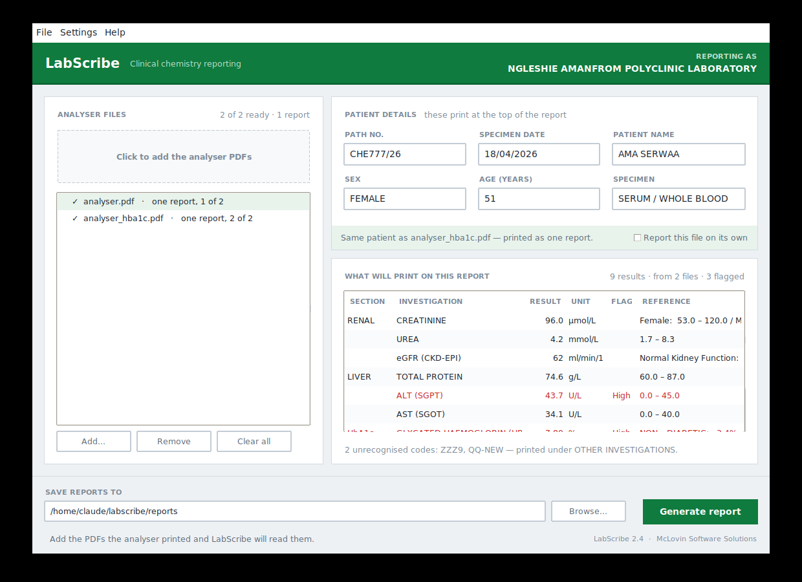
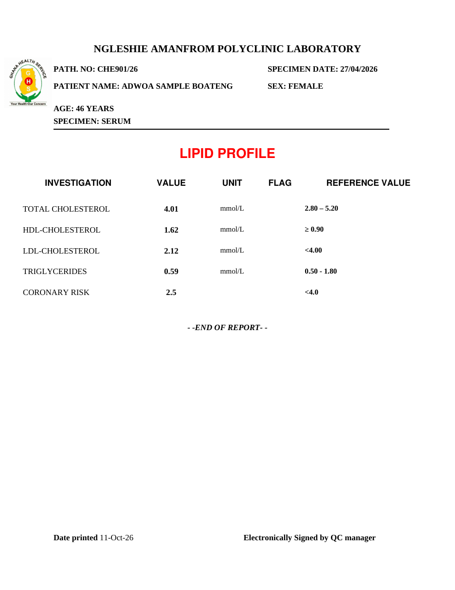
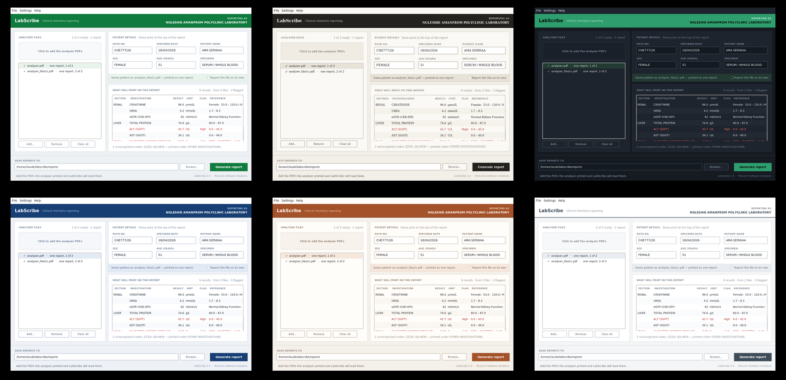

# LabScribe

A clinical chemistry analyser prints a results slip. The laboratory issues a
patient report. LabScribe does the bit in between, so nobody retypes numbers
that the analyser already printed.

It reads the PDFs a Mindray BS240 produces, works out which results belong to
which patient, applies the laboratory's reference intervals, and writes a
finished report per patient in the layout the laboratory actually uses.

Written for the chemistry bench at Ngleshie Amanfrom Polyclinic, Accra.

## What it handles

**Two files, one patient.** A renal/liver/lipid run and an HbA1c run arrive as
separate PDFs. LabScribe recognises that they are the same person — including
when the analyser writes the name as `BOATENG, ADWOA SAMPLE` on one and
`Adwoa Sample Boateng` on the other — and prints them as one report. Tick a box
to keep a file separate if you want it on its own.

**Reference intervals and flags.** Each result is checked against the
laboratory's own intervals, sex-specific where that matters, and flagged high
or low. The intervals live in one table in the source, so updating them is an
edit in one place rather than a search through the code.

**eGFR.** Calculated by CKD-EPI from creatinine, age and sex. If the analyser
already printed one, that value is left alone rather than overwritten.

**Test codes it does not know.** Anything unrecognised is printed under OTHER
INVESTIGATIONS instead of being silently dropped, and the window says which
codes they were.

**Files that will not read.** Analyser PDFs vary, and some are scans with no
text at all. Rather than failing with a stack trace, LabScribe shows what it
found in the file, which reader it tried, and which rows looked like tests but
carried no number — enough to tell a bad scan from an unfamiliar layout.

**Anything the parser got wrong** can be typed over in the window before the
report is generated.

## The report

Ghana Health Service logo, centred laboratory name, the sections in the order
the laboratory uses, borderless five-column tables, and a signature footer.

## Themes

## Running it

    python LabScribe.py                 # drag-and-drop window
    python LabScribe.py patient.pdf     # one file, straight to a report
    python LabScribe.py --demo          # sample renal/liver/lipid report
    python LabScribe.py --demo-hba1c    # sample HbA1c report

Python 3.8+, with `pdfplumber` and `reportlab`. tkinter ships with Python on
Windows and macOS; on Linux, `sudo apt install python3-tk`.

    pip install pdfplumber reportlab

## Tests

    python test_LabScribe_2.4.py

26 checks covering patient matching, name-order handling, the merge rules,
report contents, output file naming and the eGFR calculation. They run without
a window and without an analyser file.

## Adapting it to another laboratory

Three places in `LabScribe.py`:

| Section | What is in it |
|---|---|
| 2 | Laboratory name, signatory line, page geometry, whether flags print |
| 5 | Analyser short codes mapped to full test names |
| 6 | Reference intervals and units |

## A note on the sample data

Every patient in this repository is invented. `sample_hba1c.pdf`,
`sample_renal_liver_lipid.pdf` and the screenshots are generated from the demo
records built into the source. No real patient data is here, and none should be
committed to it.
